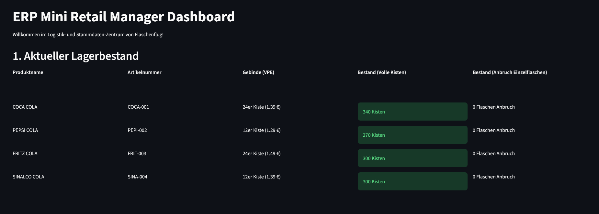
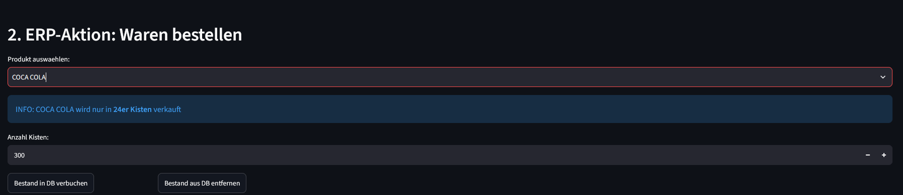
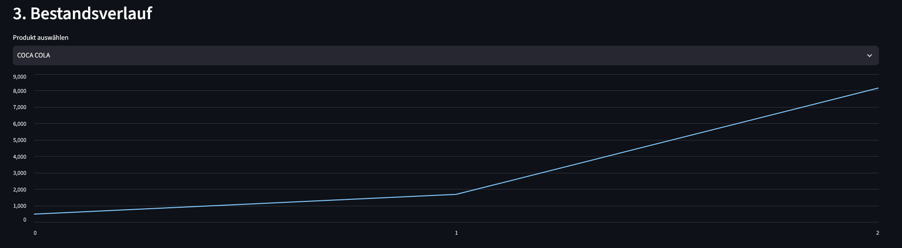

# Mini-ERP und Inventory Management Dashboard

Ein kompakter **Enterprise-Resource-Planning (ERP)** und **Warehouse Management System (WMS)** Prototyp für einen imaginären Getränke-Großhandel.

In diesem Projekt setze ich mich mit relationalen Datenbanksystemen (SQLite), der entsprechenden Backend-Logik mit Python und der Entwicklung einer Weboberfläche für Benutzer durch das Streamlit Framework auseinander.

---
## Features

* **Echtzeit-Inventur:** Der aktuelle Stand der Datenbank kann jederzeit angezeigt werden, um einen genauen Überblick über den Warenbestand zu erhalten.
* **Wareneinkauf und -verkauf:** Waren können über einen Knpfdruck eingekauft und ausgebucht werden.
* **Historischer Bestandsverlauf:** Bei bestehender Lagerhistorie kann der Verlau eines jedes Produkts eingesehen werden.

---
## Einblick in das Dashboard (Screenshots)
Ein kleiner visueller Einblick in die Benutzeroberfläche des ERP-Prototyps.

### 1. Lagerbestand:
Die Benutzeroberfläche zeigt die Bestände in Echtzeit, augeteilt nach herstellerspezifischen Verpackungseinheiten (VPE). Kritische Warenmengen werden farblich hervorgehoben:



### 2. Wareneingang und -ausgang
Hier können neue Kisten nachbestellt oder ausgebucht werden. Die Kisten werden mittels SQL-Querys in die Datenbank geschrieben.



### 3. Historische Analytics (Bestandsverlauf)
Hier zeigt ein interaktives Diagramm die Bestandentwicklung über die Zeit an. Die Daten werden mittels SQL-Querys aus der Datenbank gelesen.



Screenshots zeigen natürlich nicht wie das Systewm funktioniert. Um das System auf einem lokalen Rechner zu starten, folgen Sie [der Anleitung](##Installation-und-Lokaler-Start).

---
## Datenmodell (ER-Diagramm)

Das relationale Datenmodell basiert auf der Krähenfuß-Notation. Es wurde über das Tool [databasediagram.com](https://databasediagram.com/app) entwickelt:


---
## Genutzte Technologien

* **Backend & Logik:** Python 3 (inkl. 'sqlite3', 'os')
* **Datenverarbeitung & Anaytics:** Pandas  
* **Datenbank:** SQLite (dateibasierte relationale DB)
* **Frontend / UI:** Streamlit (Interaktives Web-Framework)
* **Grafiken:** databasediagram.com

---
## Installation und Lokaler Start

### 1. Repository klonen
```bash
git clone https://github.com
cd mini-erp-dashboard
```

### 2. Abhängigkeiten installieren
```bash
py -m pip install -r requirements.txt
```

### 3. Anwendung starten
```bash
py -m streamlit run app.py
```
*Nach wenigen Sekunden öffnet sich das Dashboard automatisch in Ihrem Standard-Browser unter `http://localhost:8501`.*

---
## Datenbank-Architektur im Detail

Um Datenredundanzen und Inkonsistenzen im ERP-System vollständig zu vermeiden, steuert das System die Bestände über zwei zentrale Prinzipien:

1. **Atomare Speicherung:** Der einzige physisch veränderbare Zähler in der Tabelle `produkte` ist `gesamt_flaschen` (die kleinstmögliche logistische Einheit). Einzelflaschenbruch oder Teilmengen führen somit nie zu Rundungsfehlern.
2.  **Transaktions-Logging:** Bestandsveränderungen werden nicht flüchtig überschrieben, sondern zeitscharf in der Tabelle `lager_historie` mitgeschrieben. Der zeitliche Verlauf im Frontend wird performant über die kumulierte Summe (`cumsum()`) des transaktionalen Deltas errechnet.

---
## Roadmap & zukünftige Features

Ich plane dieses Projekt zukünftig stetig weiterzuentwickeln. Die folgenden Ideen möchte ich noch umsetzen:

- [ ] **Login-System nach Rollen:** Absicherung des Dashboards durch ein Login-Menü, welches zwischen Administrator, Logistik-Mitarbeiter und Gast unterscheidet
- [ ] **Erweiterte visuelle Analytics:** Mehr Möglichkeiten sich den Warenbestand im Dashboard anzeigen zu lassen und Trends zu erkennen
- [ ] **Automatisierte Daten-Generierung:** Zu Demo zwecken soll per Knopfdruck eine Lagerhistorie generiert werden können
- [ ] **Cloud Deployment:** Unabhängig von Standort aufrufbar. Hierzu ist ein Wechsel von SQLite zu PostgreSQL nötig
- [ ] **Interaktives User-Tutorial:** Zu Demo zwecken soll es eine kurze Einleitung in das Dashboard geben
